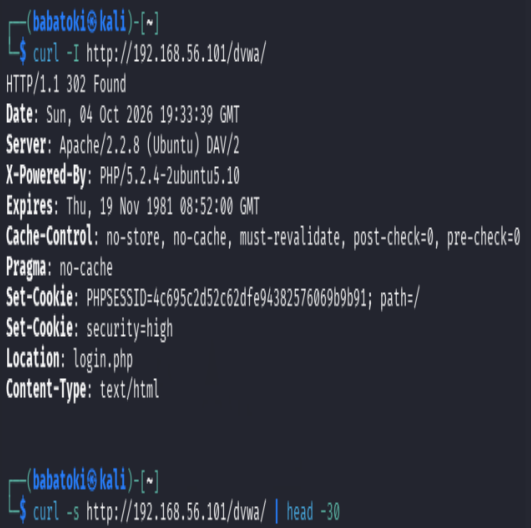
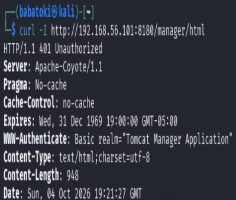
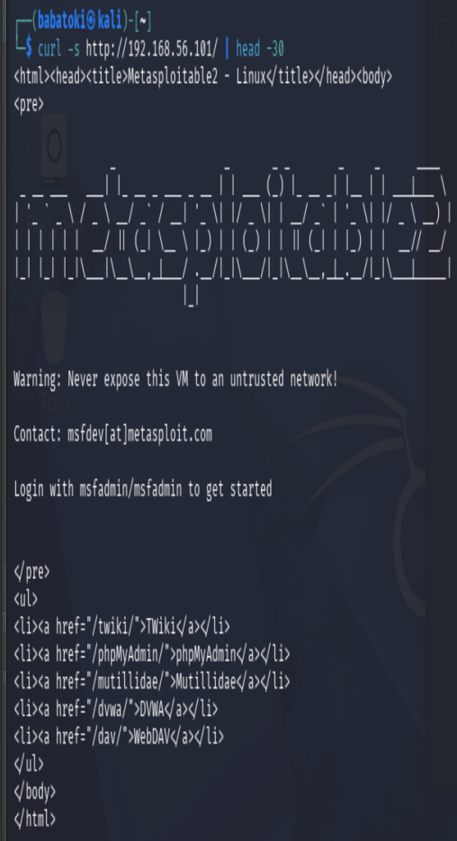
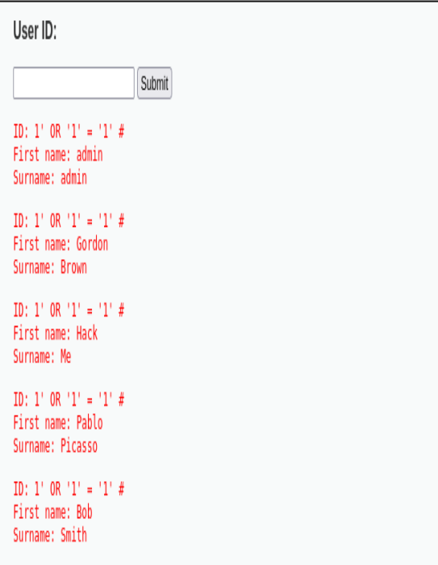
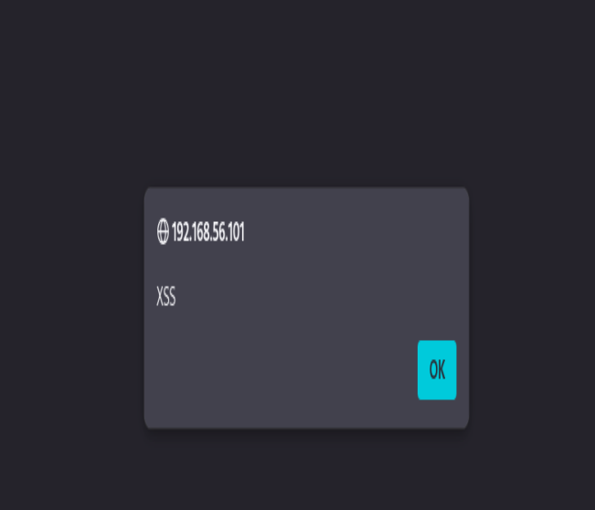
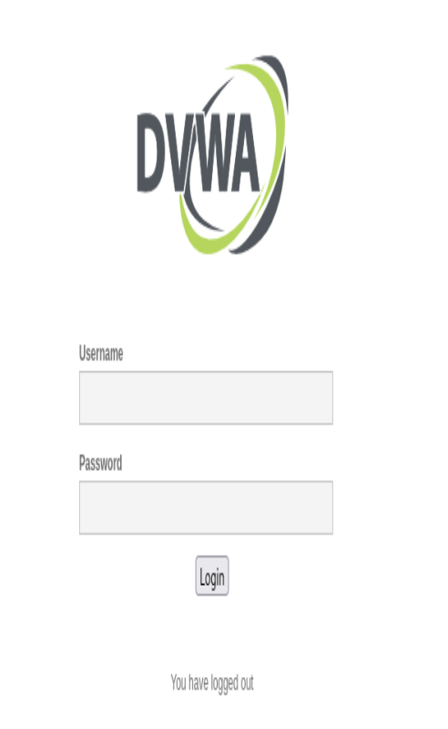

# DVWA Web Application Security Assessment

## Overview

This project documents a controlled web application security assessment performed against Damn Vulnerable Web Application (DVWA), an intentionally vulnerable application designed for security testing and education.

The assessment was conducted from a Kali Linux virtual machine in an isolated laboratory environment. Testing focused on reconnaissance, information disclosure, directory exposure, SQL injection, reflected cross-site scripting (XSS), and session/logout behavior.

> **Disclaimer:** All testing was performed against an intentionally vulnerable application in an authorized laboratory environment. No unauthorized systems were targeted.

## Objectives

- Perform web application reconnaissance.
- Identify information disclosure issues.
- Identify exposed directories and resources.
- Test for SQL injection vulnerabilities.
- Test for reflected cross-site scripting.
- Examine session and logout behavior.
- Capture evidence of identified findings.
- Assess the potential security impact of each finding.
- Provide appropriate remediation recommendations.
- Produce professional security assessment documentation.

## Lab Environment

**Testing machine**
- Kali Linux
- Nmap
- cURL
- Web browser
- Burp Suite where applicable

**Target application**
- Damn Vulnerable Web Application (DVWA)
- Hosted within an isolated virtualized laboratory

## Methodology

The assessment followed a structured penetration-testing workflow:

1. Reconnaissance
2. Web enumeration
3. Information disclosure testing
4. Directory/resource discovery
5. Injection testing
6. Cross-site scripting testing
7. Session and authentication testing
8. Evidence collection
9. Risk assessment
10. Remediation recommendations

## Findings

| Finding | Category | Severity |
|---|---|---|
| PHP Information Disclosure | Information Disclosure | Medium |
| Directory Listing | Security Misconfiguration | Medium |
| SQL Injection | Injection | High |
| Reflected XSS | Cross-Site Scripting | Medium |
| Session/Logout Weakness | Session Management | Medium |

## Evidence

### Web Enumeration

Initial reconnaissance and web enumeration were performed against the target application.



### PHP Information Disclosure

Accessible PHP configuration information was identified during enumeration.



### Directory Listing

Directory listing behavior exposed application resources that should normally be restricted.



### SQL Injection

SQL injection testing demonstrated the application's susceptibility to malicious database queries.



### Reflected XSS

Reflected cross-site scripting testing demonstrated that user-controlled input could be reflected into the application's response without adequate output encoding.



### Session and Logout Testing

Session and logout behavior was assessed to evaluate how effectively the application terminates authenticated sessions.



## Security Impact

### SQL Injection — High

SQL injection can allow an attacker to manipulate backend database queries. Depending on the application's privileges and database configuration, successful exploitation may result in unauthorized data access, modification, or other compromise.

### Reflected XSS — Medium

Reflected XSS can allow malicious scripts to execute in a victim's browser when the victim interacts with a crafted request or link. Potential consequences include session compromise, phishing, or unauthorized actions performed in the victim's browser context.

### Information Disclosure — Medium

Exposing PHP configuration information can reveal server configuration details that assist attackers during reconnaissance and vulnerability identification.

### Directory Listing — Medium

Directory listing can expose files, application resources, configuration information, backups, or other content that was not intended for direct public access.

### Session Management — Medium

Weak session termination can increase the risk of unauthorized access if an attacker obtains a valid session identifier or gains access to a user's previously authenticated browser session.

## Recommended Remediation

- Use parameterized queries and prepared statements to prevent SQL injection.
- Validate and sanitize user-controlled input.
- Apply context-aware output encoding to prevent XSS.
- Disable unnecessary PHP information disclosure in production.
- Disable directory indexing unless explicitly required.
- Implement secure session invalidation during logout.
- Regenerate session identifiers after authentication.
- Apply secure cookie attributes such as `HttpOnly`, `Secure`, and appropriate `SameSite` settings.
- Maintain current application and server security patches.
- Apply least-privilege principles to application and database accounts.
- Implement security testing throughout the software development lifecycle.

## Skills Demonstrated

This project demonstrates practical experience with:

- Web application reconnaissance
- Web enumeration
- SQL injection testing
- Cross-site scripting testing
- Session security testing
- Information disclosure analysis
- Security misconfiguration analysis
- Evidence collection
- Risk assessment
- Penetration-testing methodology
- Kali Linux security tooling
- Security documentation and reporting

## Project Structure

```text
DVWA-Web-Security-Assessment/
├── README.md
├── screenshots/
│   ├── reconnaissance/
│   │   └── 01-web-enumeration.png
│   ├── enumeration/
│   │   ├── 02-phpinfo.png
│   │   └── 03-directory-listing.png
│   └── findings/
│       ├── 04-sql-injection.png
│       ├── 05-reflected-xss.png
│       └── 06-session-logout.png
└── REPORT.md
```

## Ethical Use

This project is intended strictly for authorized security testing, cybersecurity education, and controlled laboratory environments.

Do not use these techniques against systems or applications without explicit authorization.
